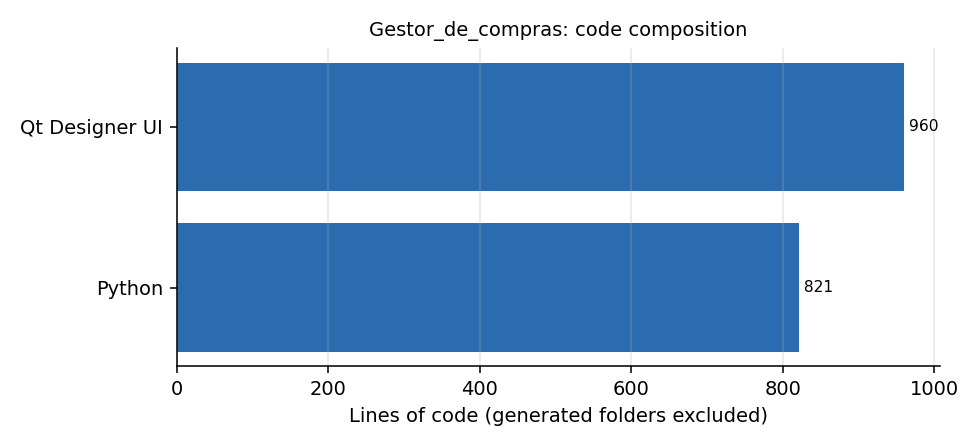

# Gestor_de_compras

**Desktop tool to track public-procurement contracts (licitacoes): who the client is, what was contracted, what was delivered and what remains.** Python and PyQt5 over a SQLite database, with a login. *Em portugues: gestor de licitacoes com login, cadastro de produtos e acompanhamento de contratado, enviado e restante.*

## What is in it

| File | What it does |
|---|---|
| `Login.pyw`, `Interface_Py_Login.py`, `Defs_Login.py` | Login window and its authentication helpers |
| `Licitacoes.py` / `.ui` | Contract screen: tender number, client, registration and expiry dates, quantities **contracted, sent and remaining**, buttons to deliver, edit and print a report |
| `CadastroProdutos.pyw` / `.ui` | Product registration |
| `CriaBDSqlite.py`, `DATA.db` | Creates and ships the local database |



## Run

```bash
pip install PyQt5
python Login.pyw
```

## Status

Early prototype (Python 3.5 era). The screens and the data model are there; the delivery workflow is only partly connected. The domain (tracking what was contracted against what was delivered for each tender) is the same one that the public procurement analyses in the portfolio repositories work with.
